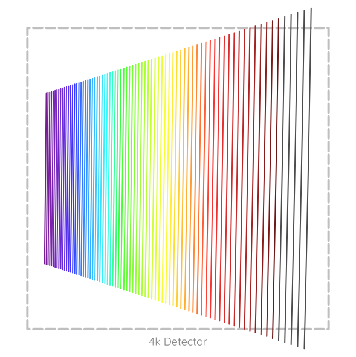

# Curved Air

A repository of code largely developed during my PhD thesis, applicable to several areas of optical design tasks.

Contains code for optimisation of compound prisms (in particular for development of atmospheric dispersion correctors [ADCs]); narrowing down the options for the main parameters of an echelle spectrograph; numerical simulation of Fabry-Pérot etalons, computing PSFs from telescope pupil geometries, etc.


## Installation

I recommend using [`uv`](https://astral.sh/uv) to manage Python packages, dependencies and virtual environments. To run code in this repository with `uv`:

```bash
git clone https://github.com/pemberj/curved_air
```

And simply:

```bash
uv run ./example_scripts/spectrographs/simple_echelle.py
```

`uv` will pull and install all the relevant dependencies into a virtual environment and run the code.


## Using `curved_air` objects to model an echelle spectrograph

Throughout this repository I have used [AstroPy](https://www.astropy.org/) `units` to manage physical quantities. Most functions should also accept regular floats or integers but will assume a default unit (and inform the user about this assumption).

```python
import numpy as np
from astropy import units as u
from matplotlib import pyplot as plt

from curved_air.detectors import Detector
from curved_air.instruments.echelle import EchelleSpectrograph
from curved_air.optics.dispersers import EchelleGrating, SimpleGrating
from curved_air.plotting import plot_style, wavelength_to_rgb

plt.style.use(plot_style)

simple_echelle = EchelleSpectrograph(
    name="Simple echelle spectrograph",
    grating=EchelleGrating(
        groove_frequency=31.6 / u.mm,
        blaze_angle=76 * u.deg,
        gamma_angle=0.5 * u.deg,
    ),
    cross_disperser=SimpleGrating(
        groove_frequency=200 / u.mm,
    ),
    detector=Detector(
        name="4k Detector",
        pixel_size=9 * u.um,
        nx=4096,
        ny=4096,
    ),
    min_wl=400 * u.nm,
    max_wl=800 * u.nm,
    beam_diameter=100 * u.mm,
    camera_focal_length=400 * u.mm,
    slit_width=50 * u.um,
    slit_length=200 * u.um,
    slit_native_focal_ratio=4,
)

simple_echelle.print_parameters()

fig: plt.Figure = plt.figure()
ax: plt.Axes = fig.gca()

simple_echelle.plot_detector_edge(ax=ax)

for m in simple_echelle.spectral_orders:
    wls = simple_echelle.order_wavelengths(m=m, num=20)
    xs, ys = np.transpose(simple_echelle.image_plane_position(m=m, wavelength=wls))
    ax.plot(xs, ys, color=wavelength_to_rgb(wls[0]))

ax.set_aspect("equal")
ax.axis("off")

plt.show()
```

### Output:
```
Collimated beam diameter:          100 mm
Slit magnification factor:         1x
Slit length at detector:           22.2 pixels
Bluest orders separation:          23.2 pixels
Reddest orders separation:         92 pixels
Slit width (object plane):         50 um
Slit length (object plane):        200 um
Slit width (image plane):          50 um
Sampling of slit image:            5.56 pixels
Spectral resolution @ 600 nm:      64,273
```



## Streamlit web-app

Also included here are various web-app frontends for the underlying code. I host the web-app on my [website](https://www.jakepember.com) and on its own subdomain at [curvedair.jakepember.com](https://curvedair.jakepember.com).

To run this web-app yourself locally, run

```bash
uv run ./src/curved_air/webapp/app.py
```

and navigate to the IP address and port that is reported in the terminal output.

The current roster of web-apps includes:
* [Echelle Spectrograph](https://curvedair.jakepember.com/echelle_spectrograph) - an app to explore the top-level design space for echelle spectrographs. Specify the slit width, collimated beam diameter, echelle and cross-disperser parameters, camera focal length, and detector, and the app will calculate the spectral resolution, order separation, slit sampling, etc., as well as produce an echellogram plot for the instrument.
* [Low Resolution Spectrograph](https://curvedair.jakepember.com/low_resolution_spectrograph) - an app to explore the design space for low-resolution spectrographs. Specify the key instrument parameters and the app will calculate the spectral resolution, order separation, slit sampling, etc., as well as produce a spectrum plot for the instrument.
* [Atmospheric Dispersion Corrector](https://curvedair.jakepember.com/atmospheric_dispersion_corrector) - For a given combination of two or more optical glasses, this app will optimise the angles to create a rotational atmospheric dispersion corrector from compound prisms.
* [Instrument Transmission](https://curvedair.jakepember.com/instrument_transmission) - Specify transmission curves for various parts of an instrument chain (telescope, optical fibre, grating, detector, etc.) and this app will produce a transmission waterfall plot showing the impact of each component on the overall optical transmission of the system.
* [Glass Explorer](https://curvedair.jakepember.com/glass_explorer) - Explore the refractive index and Abbe number of optical glasses in catalogues from various manufacturers (or upload your own catalogue). See how equivalent glasses from different manufacturers compare to one another, or use the differential Abbe number and differential Relative Partial Dispersion to find the best glass combinations for achromatic colour correction.
* [Fibre Loss Converter](https://curvedair.jakepember.com/fibre_loss_converter) - A simple app to convert between fibre loss in dB and percentage transmission, either for a single value or for a measured curve. Scale a single measurement up for longer fibres.
* [Surface Tolerances](https://curvedair.jakepember.com/surface_tolerances) - For given optical surface parameters (diameter and radius of curvature), convert between tolerances specified in fringes, sag, or deviation in radius or curvature.
* [Interferograms](https://curvedair.jakepember.com/interferograms) - Load a file from either a Zygo or Fisba interferometer and visualise the interferogram data. Apply cosmetic or geometric corrections, fit Zernike polynomials, and visualise the resulting surface map. You can also export data in formats compatible with `Grid Sag` or `Grid Phase` surfaces ready to import and use in an "as-built" Zemax model of your optical system.
* [Telescope Designer](https://curvedair.jakepember.com/telescope_designer) - Compute the mirror prescription for a range of cassegrain telescope designs.
* [CTE Match](https://curvedair.jakepember.com/cte_match) - For a given optical glass, use this app to find the materials with the closest coefficient of thermal expansion (CTE). Useful for selecting materials for optical mounts or opto-mechanical assemblies where thermal stability is important.
* [Solid Angle & Étendue](https://curvedair.jakepember.com/solid_angle_and_etendue) - A simple calculator to convert between half- and full-cone angle, focal ratio (f-number) and numerical aperture.
* [Guide Image Simulator](https://curvedair.jakepember.com/guide_image_simulator) - Use this app to simulate the performance of a guiding system for a telescope. Input the system parameters (seeing quality, image quality, focal length, detector pixel size) and preview the resulting star image on the guide detector.
* [Guide Star FoV](https://curvedair.jakepember.com/guide_star_fov) - Use this app to estimate the field of view required so that any given telescope pointing is expected to contain at least one star brighter than a chosen magnitude limit, or vice-versa to estimate the brightest magnitude limit for which at least one star is expected within a field of view of a particular angular size.
